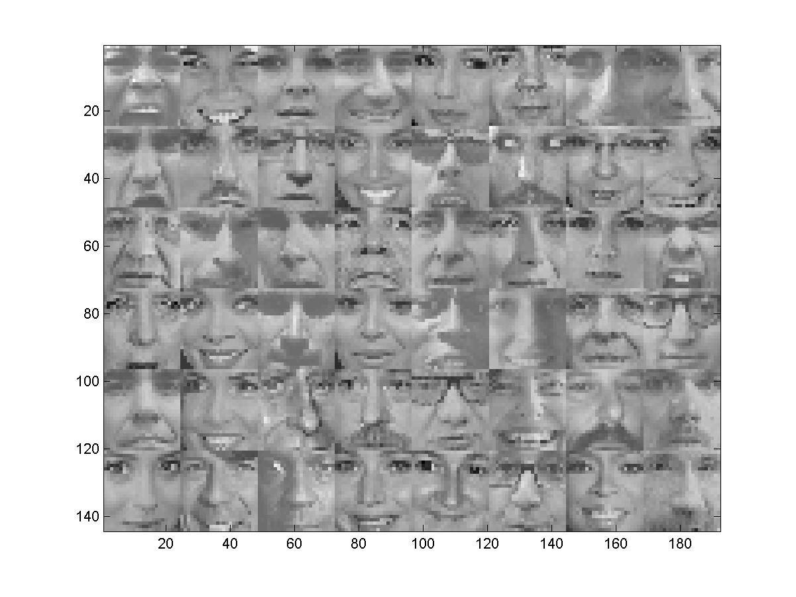
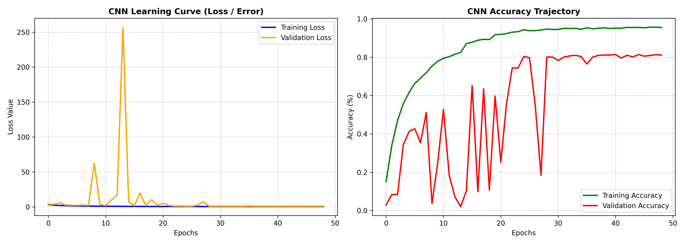
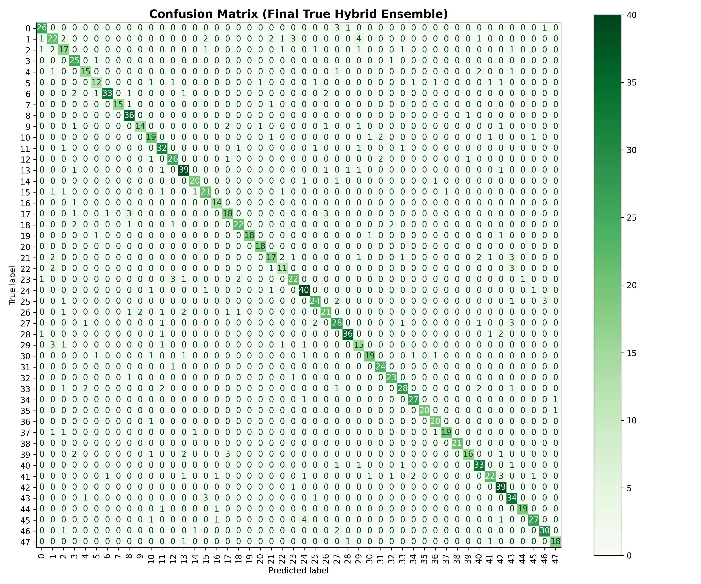

# Famous48 Face Recognition – Random Forest + CNN Hybrid

Recognising 48 famous people from low-resolution 24×24 grayscale face images by combining a Random Forest on hand-crafted features with a convolutional neural network.
Team project by **Semih Elmas** and **Emre Aydın** ([@emreeaaydin](https://github.com/emreeaaydin)).



## Dataset
**Famous48** – 6,835 face images of 48 well-known people, 73–226 images per person, 24×24 pixels each.
File format: see [DATASET.md](DATASET.md).

## Approach

### Model A – Random Forest on hand-crafted features
Features implemented from scratch in NumPy (no OpenCV / scikit-image):
- **Local Binary Patterns (LBP)** – 8-neighbour texture codes, with 256-bin histograms for each of the four 12×12 face quadrants
- **Spatial moments** – mass, centre of mass and variance per quadrant, z-score normalised
- Combined with the raw pixels and fed to a 150-tree Random Forest (scikit-learn)

### Model B – CNN (TensorFlow/Keras)
- 3 convolutional layers (32-32-64 filters) with batch normalisation, max pooling, global average pooling, dropout and L2 regularisation
- **Cutout augmentation** written in NumPy (random 4×4 block erased), doubling the training set
- Learning-rate reduction and early stopping

### Hybrid
For each image: if the Random Forest is more than 40% confident, its prediction is used; otherwise the CNN's prediction if it is more than 40% confident; otherwise a weighted blend (65% RF / 35% CNN) of both models' probabilities.

## Results
Stratified 80/20 train/test split.

| Model | Test accuracy |
|---|---|
| Random Forest | 67.37% |
| CNN | 81.78% |
| Hybrid | 82.08% |




## How to run
```bash
pip install -r requirements.txt
python main.py
```

## Tech stack
Python · NumPy · scikit-learn · TensorFlow/Keras · Matplotlib
